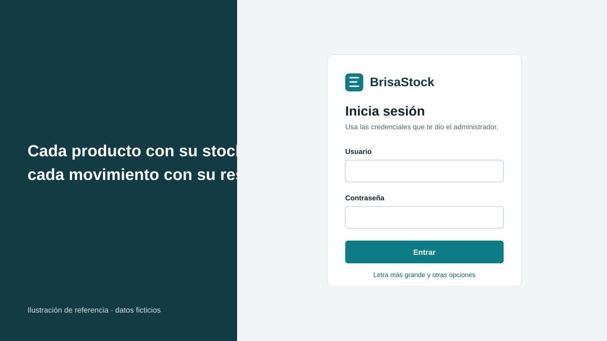

# Manual de usuario de BrisaStock

BrisaStock permite consultar productos, registrar ventas y controlar los movimientos de inventario de un negocio. Este manual describe las opciones que existen en la aplicación y distingue las funciones según el rol de la cuenta.

> Las imágenes de esta guía son ilustraciones de referencia basadas en la interfaz del proyecto. No son capturas de una sesión real ni contienen datos de un negocio.

## 1. Requisitos y acceso

Para iniciar la aplicación se requiere Java 21 y una base de datos MariaDB o MySQL preparada como se explica en [README.md](../README.md). En Windows, desde la carpeta del proyecto, se ejecuta:

```powershell
.\mvnw.cmd spring-boot:run
```

Luego se abre <http://localhost:9090/>. El administrador del negocio debe entregar al usuario su nombre de usuario y contraseña. No existe un registro público desde la pantalla de inicio.



Escribe las credenciales y selecciona **Entrar**. Si los datos no son válidos o la cuenta está desactivada, la pantalla muestra un mensaje. El botón de accesibilidad también está disponible antes de iniciar sesión.

## 2. Roles y navegación

La barra lateral permite abrir las secciones habilitadas para la cuenta. El nombre y el rol conectado aparecen en la parte superior. En pantallas pequeñas, el botón de menú abre la navegación lateral.

- **Usuario (USER):** consulta el panel y los productos, registra ventas y registra entradas de mercancía.
- **Administrador (ADMIN):** además consulta el historial de ventas y movimientos, cancela ventas, gestiona productos, consulta reportes y crea usuarios.

El servidor valida los permisos al recibir cada operación. Que un botón no aparezca en la interfaz no reemplaza esa validación.


El panel resume productos, stock bajo, agotados y vencidos. La lista **Para reponer** ayuda a encontrar productos que llegaron a su stock mínimo. Los administradores también ven las ventas recientes.

## 3. Buscar una sección o un producto

Selecciona **Buscar** en la barra superior, pulsa `Ctrl + K` o pulsa `/` cuando no estés escribiendo en un campo. Escribe el nombre de una sección, producto, marca o categoría. La búsqueda ignora mayúsculas y tildes; por ejemplo, `cafe` puede encontrar `Café`. Usa las flechas para recorrer resultados, `Enter` para abrir uno y `Esc` para cerrar.

Los resultados de navegación respetan el rol conectado. La búsqueda de productos muestra hasta ocho coincidencias a la vez.

## 4. Consultar y administrar productos

En **Productos** puedes buscar por nombre, filtrar por estado o abrir un producto por su ID. La lista muestra precio, stock y estado. Selecciona **Ver** para consultar el detalle. La búsqueda por nombre admite coincidencias parciales.

Los administradores también pueden crear y editar productos. Para crear uno, completa nombre, precios y stock inicial; los demás datos son opcionales. Al editarlo, los datos administrativos se guardan sin alterar las existencias: los cambios de stock se registran desde **Inventario**. El stock mínimo define cuándo un producto aparece como bajo. Un producto puede desactivarse y reactivarse desde sus acciones; desactivarlo conserva el historial, pero impide venderlo.

## 5. Registrar movimientos de inventario

Abre **Inventario**, elige una operación y selecciona el producto de la lista. La pantalla muestra su stock actual y mínimo.

1. **Entrada:** suma unidades recibidas. USER y ADMIN pueden registrarla. Puedes añadir una referencia y una observación.
2. **Salida:** resta unidades. Solo ADMIN puede registrarla y debe confirmar la operación.
3. **Ajuste:** fija el stock en un nuevo valor. Solo ADMIN puede hacerlo; debe escribir el motivo y confirmar.

Cada operación aceptada queda en el historial con fecha, responsable y stock anterior y posterior. Los movimientos no se editan ni se borran desde la aplicación. ADMIN puede filtrar el historial por producto y elegir entre los últimos 50, 200 o 1000 registros.

## 6. Registrar y consultar ventas

En **Ventas**, escribe parte del nombre de un producto y agrégalo al carrito. Elige las cantidades y revisa las líneas antes de registrar. El total que aparece mientras armas la venta es una estimación; el servidor confirma el precio, la existencia y el total al guardar. Si algo cambió o no hay stock, la venta no se registra y aparece un mensaje para corregirla.

USER y ADMIN pueden registrar ventas. Solo ADMIN ve la pestaña **Historial de ventas**. Allí puede abrir el detalle o cancelar una venta activa. La cancelación devuelve las unidades al inventario, solicita confirmación y puede guardar un motivo; una cancelación no se puede deshacer.

## 7. Reportes y usuarios (ADMIN)

En **Reportes** puedes consultar productos con stock bajo, agotados o vencidos. Los productos desactivados no se incluyen en estas alertas.

En **Usuarios**, ADMIN puede consultar las cuentas y crear otra indicando nombre, usuario, contraseña inicial, rol y estado. El nombre de usuario debe tener entre 3 y 50 letras, números, puntos, guiones o guiones bajos. La contraseña inicial requiere al menos 8 caracteres. La aplicación no ofrece actualmente una pantalla para cambiar contraseñas ni para desactivar usuarios después de crearlos.

## 8. Accesibilidad y cierre de sesión

El botón **Accesibilidad** permite cambiar el tamaño de letra, activar alto contraste, agrandar controles y reducir animaciones. Las preferencias se guardan en el navegador de ese dispositivo. No guardes las credenciales en un equipo compartido.

Selecciona **Cerrar sesión** al terminar. Si la sesión dejó de ser válida, vuelve a iniciar sesión con tus credenciales.

## 9. Problemas frecuentes

- **No puedo entrar:** comprueba el usuario y la contraseña con el administrador. Una cuenta desactivada tampoco puede iniciar sesión.
- **No veo una sección o acción:** puede depender del rol. Pide a ADMIN que confirme los permisos de tu cuenta.
- **No se pudo registrar una venta:** revisa el stock y el estado del producto; vencidos, desactivados o agotados no se pueden vender.
- **Falló una operación de inventario:** comprueba que seleccionaste un producto de la lista, que la cantidad sea un entero y que el ajuste tenga un motivo.
- **La aplicación no carga:** confirma que el servidor esté iniciado y que la base de datos configurada esté disponible. Los requisitos y la configuración están en [README.md](../README.md).

## Seguridad y límites

Usa solo las credenciales entregadas por el administrador. No incluyas contraseñas, datos personales ni información real del negocio en capturas que vayas a compartir. La aplicación usa HTTP Basic y el proyecto no configura HTTPS; consulta la sección de seguridad del README antes de exponerla fuera de una red local de confianza.

Para contribuir al código, consulta la [guía del equipo](../CONTRIBUIR.md). Este manual describe la interfaz existente; no implica que las funciones pendientes de desarrollo ya estén disponibles.
