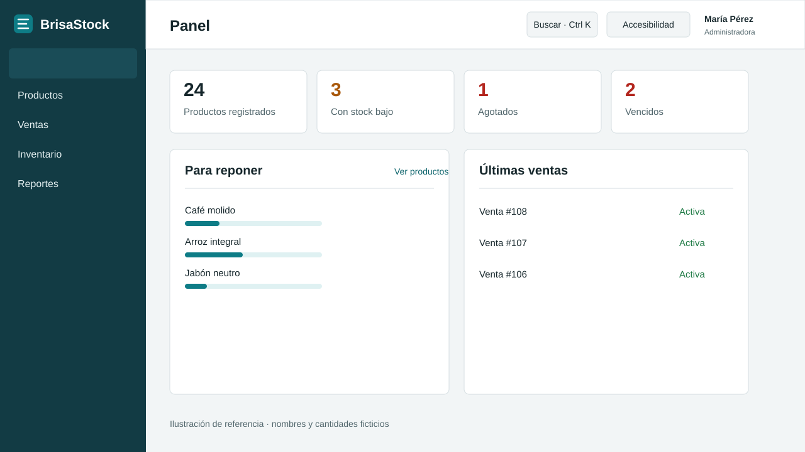

# Manual de usuario de BrisaStock

BrisaStock permite consultar productos, registrar ventas y controlar los movimientos de inventario de un negocio. Este manual describe las opciones que existen en la aplicación y distingue las funciones según el rol de la cuenta.

> Las imágenes de esta guía son ilustraciones de referencia basadas en la interfaz del proyecto. No son capturas de una sesión real ni contienen datos de un negocio.

## 1. Requisitos y acceso

Para iniciar la aplicación se requiere Java 21 y una base de datos MariaDB o MySQL preparada como se explica en [README.md](../README.md). En Windows, desde la carpeta del proyecto, se ejecuta:

```powershell
.\mvnw.cmd spring-boot:run
```

Luego se abre <http://localhost:9090/>. El administrador del negocio debe entregar al usuario su nombre de usuario y contraseña. No existe un registro público desde la pantalla de inicio.


Escribe las credenciales y selecciona **Entrar**. Si los datos no son válidos o la cuenta está desactivada, la pantalla muestra un mensaje. El botón de accesibilidad también está disponible antes de iniciar sesión.

## 2. Roles y navegación

La barra lateral permite abrir las secciones habilitadas para la cuenta. El nombre y el rol conectado aparecen en la parte superior. En pantallas pequeñas, el botón de menú abre la navegación lateral.

- **Usuario (USER):** consulta el panel y los productos, registra ventas y registra entradas de mercancía.
- **Administrador (ADMIN):** además consulta el historial de ventas y movimientos, cancela ventas, gestiona productos, consulta reportes y crea usuarios.

El servidor valida los permisos al recibir cada operación. Que un botón no aparezca en la interfaz no reemplaza esa validación.



El panel resume productos, stock bajo, agotados y vencidos. La lista **Para reponer** ayuda a encontrar productos que llegaron a su stock mínimo. Los administradores también ven las ventas recientes.

## 3. Buscar una sección o un producto

Selecciona **Buscar** en la barra superior, pulsa `Ctrl + K` o pulsa `/` cuando no estés escribiendo en un campo. Escribe el nombre de una sección, producto, marca o categoría. La búsqueda ignora mayúsculas y tildes; por ejemplo, `cafe` puede encontrar `Café`. Usa las flechas para recorrer resultados, `Enter` para abrir uno y `Esc` para cerrar.

Los resultados de navegación respetan el rol conectado. La búsqueda de productos muestra hasta ocho coincidencias a la vez.
